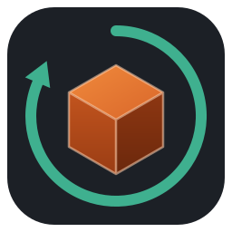

<p align="center"></p>

<h1 align="center">Oxide360</h1>

<p align="center">A parametric 3D CAD modeller for Linux, written in Rust: sketches, extrudes, fillets, sweeps, assemblies and more, in the spirit of Fusion 360.</p>

## What it does

- **Sketches** on planes and faces: lines, rectangles, circles, arcs, polygons, slots, splines, ellipses and text; constraints (coincident, parallel, tangent, equal, symmetric…) and dimensions, solved live; trim, extend, offset, fillet, mirror, patterns, projection of body edges.
- **Solids**: extrude, revolve, sweep, loft, pipe and coil; holes (counterbore, countersink, tapped) and threads; fillet, chamfer, shell, press pull, combine, move/copy; mirror and patterns.
- **Construction** planes, axes and points (offset, angle, midplane, three points, tangent, through cylinders).
- **A timeline** of every step: edit any of them, roll back, suppress; named parameters and expressions.
- **Assemblies**: components and joints (rigid, revolute, slider) with motion.
- **Inspect**: measure, section analysis, interference, physical materials and mass properties.
- **Files**: its own design format; STEP, STL, 3MF and OBJ export; STEP and STL import; DXF and SVG export of sketches. Autosave and crash recovery.

The geometry is exact (OpenCASCADE B-rep), so volumes, fillets and STEP files are the real thing, not meshes.

## Building it (Fedora)

```sh
sudo dnf install opencascade-devel cmake gcc-c++ rust cargo
cargo run --release
```

`cargo test` runs the tests (the 3D renderer's tests use Mesa's software Vulkan, so they run without a GPU).

`packaging/make-bundle.sh` builds a folder that runs on another Fedora machine without installing anything; a Flatpak is planned.

## Status

Young and moving fast. Designs saved now will keep opening in later versions.

## Credits

Made by **Gavin** ([Defanoux](https://github.com/Defanoux) · Discord: Defanoux), with Claude (Anthropic).

Built on [Open CASCADE Technology](https://dev.opencascade.org/) (LGPL 2.1 with exception), [opencascade-rs](https://github.com/bschwind/opencascade-rs) (LGPL 2.1, patched in `vendor/`), [egui](https://github.com/emilk/egui), [wgpu](https://wgpu.rs/), [glam](https://github.com/bitshifter/glam-rs), [serde](https://serde.rs/), [rfd](https://github.com/PolyMeilex/rfd), [ab_glyph](https://github.com/alexheretic/ab-glyph) and [png](https://github.com/image-rs/image-png) (MIT / Apache 2.0).

## Licence

GPL-3.0-or-later: see [LICENSE](LICENSE). You may use, change and share it; shared changes stay under the same licence.
